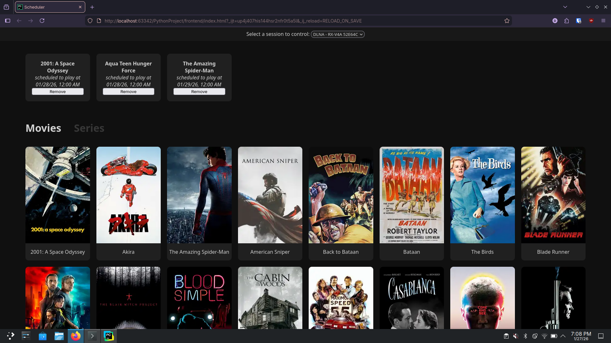
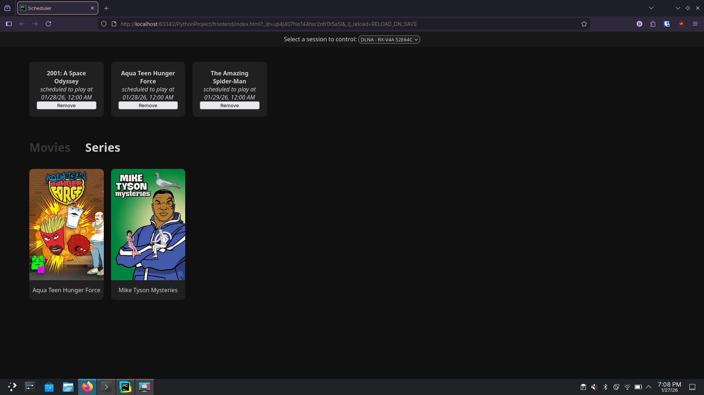
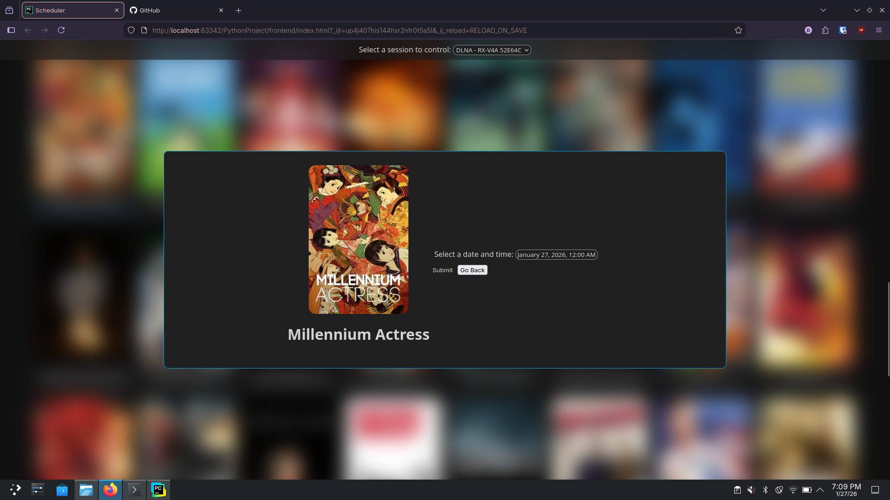

# About This Project

This is an accessibility project designed to facilitate the automation of media playback on any TV or computer using
a media app called Jellyfin. This is designed with caregivers in mind, meaning they can ensure whoever they're taking
care of can still watch the shows and movies that bring them comfort if they are incapable of using a remote or
streaming UI. My idea for this app is that it can be deployed in homes, nursing homes, and hospitals. Users can select
a movie or TV show episode, a device, and choose a time and day for it to play. Once that time hits, the device
will automatically start playing the chosen content.

# Technical Stuff
The backend for this app is built in Python, with the scheduling being handled by APScheduler, and the schedule
database being handled with SQLite. The frontend is written with Alpine.JS, meaning it's incredibly lightweight and 
responsive, coming with little to no baggage when compared to a framework like React. I really enjoyed writing
in Alpine, since the process is much more HTML forward, akin to Svelte, than React's more JS focused style. This was
also my first time designing anything with CSS, and there's definitely much room for improvement, but I am happy with how
it turned out!

# Tests

The tests run offline against a fake Jellyfin, so they never play anything on a real TV and never touch
`jobs.sqlite`. One-time setup:

```
pip install -r requirements-dev.txt
playwright install chromium
```

Then, from the project root:

```
pytest                           # everything (~10 seconds)
pytest tests/test_api.py         # backend only (~2 seconds, no browser)
pytest tests/test_frontend.py    # frontend only, in a headless browser
pytest -k episode                # only tests with "episode" in the name
pytest tests/test_frontend.py --headed --slowmo 500   # watch the browser tests run
```

- `tests/test_api.py` calls the FastAPI routes: validation, status codes, episode titles, and that jobs
  really fire and play.
- `tests/test_frontend.py` clicks through the real page with the `/api` calls faked: picking a device,
  scheduling movies and episodes, errors, closing the modal, and removing items. It needs internet,
  because Alpine is loaded from a CDN.

# Screenshots




